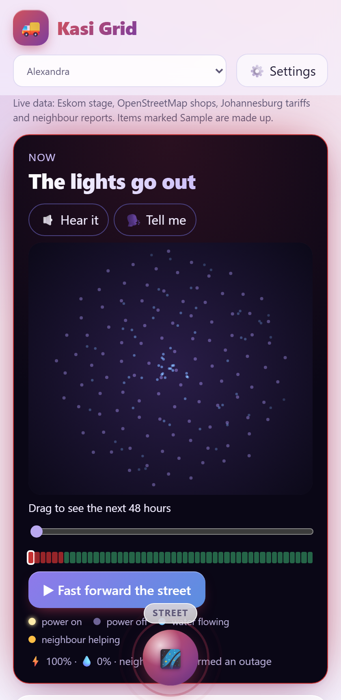

# Kasi Grid

**Know before it goes dark.** Team **Amethyst & Azure** (Tshedza Tshikovhi and Mulanga Munaka), FNB App of the Year Hackathon 2026, track: climate resilience and essential services.

- Live app: https://kasi-grid.vercel.app
- Demo video (90 seconds): https://drive.google.com/file/d/136fqIx7WRivrNcLZo90X4rfTMUO3MXxv/view?usp=drivesdk
- This repository: https://github.com/Unsolvedstar/Kasi-Grid
- Hand-in documents (PDF): [`submission/handin/`](submission/handin/)

Eskom has reported no loadshedding since 16 May 2025 (more than 500 days), but households still lose power to load reduction, cable theft and faults, and Johannesburg's water supply keeps failing. There is no stage or schedule for any of it, so people learn what is happening from rumours in a group chat, not from each other.

## What makes it different

**Kasi Grid brings a community closer together instead of pulling people apart.** Most apps ask you to look at a screen alone. This one only works when neighbours take part: three different neighbours must agree before an outage is verified, a neighbour with a generator or a charger offers help on the community board and shows on the street map as a gold light, and spazas order stock together for lower prices. It is ubuntu, "I am because we are", on a phone.

## What it does

- **A live satellite street.** The home screen is real satellite imagery of the community with every mapped home as a glowing dot. Homes go dark as the risk of a power cut rises; drag a slider through the next 48 hours.
- **Verified outages** (3 or more different devices), "back on for me" votes, an outage map, and a forecast of when outages cluster and how long they last.
- **Anywhere in South Africa.** Every place is a community of about 2 km. Reports and posts can carry an exact pin, found with a precise GPS fix.
- **A medical power plan.** A live battery countdown for a medical device (corrected by readings from the battery display), alerts at 2 hours, 1 hour, 30 minutes and empty, and a one-tap ambulance call. An emergency card texts your location to a contact without a voice call.
- **Care and equipment booking**, a **small-business outage cost** planner, **pooled restock orders** for spazas, a **community board** for offers and requests, nearby shops and clinics, and savings calculators.
- **For everyone.** Accessibility settings for people who are deaf, hard of hearing, blind or have low vision (flash, vibration, large-text and spoken alerts, screen-reader announcements, text size, high contrast, reduced motion), four languages, offline, installable.
- **Accounts are optional.** Everything works anonymously. An account (cell number or email and a password) keeps your area, language, accessibility settings and care bookings on any phone and signs you in automatically.



Long forms are step-by-step wizards. The code is a React and Vite web app (`src/`), an Express API (`server/`) and shared logic with tests (`shared/`, `tests/`).

## Run it

```
npm install
npm run dev      # API on :3000 and Vite on :5173, open http://localhost:5173
```

Production:

```
npm run build
npm start        # serves the built app and the API on :3000 (PORT to change)
```

Docker: `docker build -t kasi-grid . && docker run -p 3000:3000 -v kasi-data:/app/data kasi-grid`

Vercel: the front end is static and the API is one serverless function (`api/index.js`, `vercel.json`); it needs a hosted libSQL database such as Turso. See [DEPLOY.md](DEPLOY.md).

## Tests

```
npm test    # 111 tests: calculations, translations, the full API (admin, rate limits, care bookings, accounts), community and location rules, the battery model and alerts. Starts its own server and temporary database
```

## Outage Pulse

When 3 or more different devices report or confirm the same power or water problem in one suburb within 6 hours, the Today tab shows a **verified outage** card (`GET /api/pulse`). Neighbours can vote "It is back on for me"; once half of them (minimum 2) agree, the card turns green. People can opt in to a phone notification when a new verified outage appears while the app is open. Sample data is ignored. For a demo, run `node scripts/demo-seed.mjs http://localhost:3000 alex` to create one.

## Outage duration estimate

Next to the weekday and time-of-day pattern, `GET /api/forecast` returns `duration`: how long past outages in the suburb lasted, from the time of a report to the first "it is back on" vote. The median needs 3 past outages, and the "1 in 5 last this long" figure needs 5. It shows on the verified-outage card and in the medical power plan, which compares it with the battery runtime. For a demo, `scripts/demo-history.mjs` writes history that includes back-on votes.

## Demo mode

`DEMO_MODE=true` fills the server with ten weeks of outage history (with "back on" votes) and keeps two fresh verified outages on the map, refreshed every 30 minutes. A judge opening the app always sees verified outages, a forecast and a typical duration. The rows look like real reports and count in `/api/stats`, so **never enable it on a pilot or production database**. Without the variable nothing changes.

## Care tab (home care booking)

Modelled on the SweepSouth approach, for care at home. A family picks companion care, post-op help, a personal care assistant, or equipment only, adds equipment, and sees a fixed price before booking. The server sets the price (`shared/care.js`) and offers the job to the 3 nearest sample carers within 15 km. Oxygen needs a prescription approved first. The first carer to accept takes the job, a decline moves it to the next carer, and the family can cancel. Bookings are private to the device and are never cached by the service worker.

The same tab has a **medical power plan**: enter a device's watts and a battery's watt-hours to see how long it runs, set against any verified outage in the suburb and the outage forecast. It stays on the phone and is not medical advice.

**Not built yet:** payments, real carers and vetting, supplier prices (all rates, equipment prices and carers are placeholders), and a carer app. The `/admin` page has a **Care bookings** panel that stands in for the carer app (approve prescription, accept or decline as an offered carer, mark done). A fuller version of this idea lives in the separate `sweepsouth/homecare-app` project (Expo and Supabase).

## Moderation (admin page)

Open `/admin` and sign in with the server's `ADMIN_TOKEN`. It lists reports, board posts and community places, with flagged items first. You can hide, restore or delete each one, and see how many flags it has and a short id of the device that posted it.

- Set `ADMIN_TOKEN` to a long random value in production. If it is not set, the admin page is disabled in production.
- Outside production, a random token is generated on each start and printed in the server log.
- The page is not linked from the app, and admin responses are never cached by the service worker.

## Languages

English, isiZulu, Sesotho and Afrikaans, chosen from the header (the browser language is used the first time). **The isiZulu, Sesotho and Afrikaans texts are drafts that have not been reviewed by native speakers**, and the language menu says so. Have fluent speakers check `src/locales.js` before a public launch. Coverage: the header, Today tab, alerts, board, checklist and headings in every tab. The Save tab is now translated apart from the generated tip text; long explanatory paragraphs on the Business and Food tabs are still English. Anything missing falls back to English.

## Installable and offline

The production build is a PWA. On a phone, use the browser's "Add to home screen". After the first visit the app opens without signal and shows the last reports and board posts it saw. New reports and board posts made without signal are saved on the phone and sent automatically when it returns (a banner shows how many are waiting). Confirming, flagging and price updates still need a connection. Offline support only runs in the production build (`npm run build && npm start`), not in `npm run dev`.

## How it works

- **Frontend:** React + Vite in `src/`. Savings, business inputs, the medical plan and the emergency contact stay in the browser (local storage). Everything shared comes from the API.
- **Backend:** Express in `server/`. It stores reports, board posts, community places, prices and optional accounts in SQLite (libSQL) at `data/kasi.db`, or a hosted libSQL database (`DATABASE_URL`, or `TURSO_DATABASE_URL`).
- **Live data:** the server fetches the loadshedding stage from Eskom (cached 5 minutes) and shops and food outlets from OpenStreetMap (cached 24 hours per suburb, with a fallback mirror).
- **Identity:** anonymous by default. Each browser gets a random device id, which limits confirmations to one per device and lets authors close their own posts. Accounts are optional (`server/auth.js`): a cell number or email and a password stored only as a salted scrypt hash, with a 90-day HttpOnly session cookie so the app opens signed in. An account syncs only area, places, language and accessibility settings, and links care bookings to the person; the medical plan and emergency contact never leave the phone. Accounts can be deleted in the app.
- **Safety:** input length limits, no links or phone/ID numbers in posts, per-IP rate limits (300 reads and 30 writes a minute), and items are hidden after 3 reports from different devices.

## Configuration

| Variable | Purpose |
|---|---|
| `PORT` | Server port (default 3000) |
| `DEMO_MODE` | `true` only for the judge-facing demo instance. See Demo mode |
| `ADMIN_TOKEN` | Enables the `/admin` moderation page |
| `WRITE_LIMIT` | Writes per minute per IP (default 30) |
| `ADMIN_LIMIT` | Admin requests per minute per IP (default 60) |
| `ESP_AUTOLINK` | `off` stops the background linking of suburbs to EskomSePush areas |
| `ESP_TOKEN` (or a `.env` file) | EskomSePush API key. Enables official loadshedding time slots (see below) |
| `ESP_BASE_URL` | EskomSePush API base URL (default the 3.1 API) |
| `ESP_DAILY_LIMIT` | Calls per day the server allows itself (default 45, under the free 50) |
| `NAMC_AUTO` | Set to `off` to stop the daily NAMC food-price check |
| `DATABASE_URL` (or `TURSO_DATABASE_URL`) | libSQL/Turso URL for a hosted database. Default is the local file `data/kasi.db` |
| `DATABASE_AUTH_TOKEN` (or `TURSO_AUTH_TOKEN`) | Token for a hosted database |
| `AUTH_LIMIT` | Sign-in and sign-up attempts per minute per IP (default 10) |

Hosts with an ephemeral disk (most free tiers) lose `data/` on redeploy. Use a persistent volume or a hosted `DATABASE_URL`.

## Official loadshedding schedules (EskomSePush)

The app can show real time slots from the EskomSePush Business API 3.1 (the older 2.0 API has been retired). Get a token through the [EskomSePush API page on Gumroad](https://eskomsepush.gumroad.com/l/api) (the Personal plan gives 50 credits a day) and put it in a git-ignored `.env` file next to `package.json`:

```
ESP_TOKEN=your-token
```

The server also links unlinked suburbs by itself in the background (shortly after start, then every six hours), a few at a time so credits stay in reserve for schedules; the admin button does the same on demand. Open `/admin` and press **Test connection** to check the token. That links each township to the nearest EskomSePush area by GPS (one credit each). Townships are split into many areas (Ntuzuma A to G, for example) and neighbouring parts can be on different blocks, so the app always names the area it is using and tells people to check their exact one. Use the search box to link a different area if the nearest one is wrong.

**Choosing your own block.** On the Alerts tab, "Not your block? Change area" lets a person pick the area that matches their street from the ESP areas around their township (cached for a week, one credit per township) or search by name (cached, and capped at 8 credits a day across all visitors so schedules always have room). The choice is kept on the phone. The server only accepts areas the API has already returned, so nobody can spend credits on made-up ids, and it falls back to the township's own area if the chosen one cannot be loaded.

**Cape Town's own stage.** Cape Town sets its own stage, which can differ from Eskom's. When ESP is switched on, Cape Town suburbs follow the stage from ESP's `status` (cached for an hour, skipped when credits run low), and the header says "Live from Cape Town". Without it they follow Eskom's stage and the app says that Cape Town's may differ.

Credits are spent carefully: an area's schedule id is cached for a week and schedules are cached per schedule id for 12 hours (many suburbs share one block), and the app stops at `ESP_DAILY_LIMIT` (default 45). Suburbs without a link keep the illustrative pattern, labelled as such. The token stays on the server and is never sent to the browser.

## Food prices update themselves

Once a day the server reads the NAMC listing page, finds the newest Food Basket Price Monthly PDF, extracts Table 2 and imports it **only if** every item and pack size is recognised, the 28 prices add up to the printed total, and no price jumped more than 40%. Otherwise the previous data stays and the reason appears on the admin page, which also has a "Check for a new report" button. Verified against the live NAMC site: it downloaded and parsed the real August 2026 report.

## Cities and tariffs

Forty-nine townships in 22 municipalities across all nine provinces. The six metros with the most detail are Johannesburg, Tshwane, Ekurhuleni, Cape Town, eThekwini (Durban) and Nelson Mandela Bay (Gqeberha); the rest (Emfuleni, Mogale City, George, Stellenbosch, Drakenstein, Msunduzi, Newcastle, Buffalo City, Mangaung, Rustenburg, Matlosana, Polokwane, Thulamela, Mbombela, Emalahleni and Sol Plaatje) have a township or two each. Weather, OpenStreetMap places, food prices and EskomSePush schedules work anywhere. Tariffs for the 16 newer municipalities are marked "not added yet" and link to the municipality website; the calculator asks for the household's own rate. To add a township, add it to `shared/suburbs.js` (coordinates from OpenStreetMap) and its municipality to `CITIES` and `TARIFFS`. Each metro's tariffs live in `shared/tariffs.js` with a status: from a secondary source, estimate, proposed, percentage only, or not available. Water bands: **Johannesburg** (secondary source), **Cape Town** (one aggregator citing the City budget; the annexure itself could not be opened), and **Ekurhuleni, Tshwane and Nelson Mandela Bay as estimates**, meaning the municipality's own published 2025/26 rates (read from the official tariff PDFs) raised by the announced 2026/27 percentage. **eThekwini** has no water bands we could read (its official tariff book is a scanned image), so the calculator asks for the household's own rand-per-kL rate instead of guessing. Electricity blocks are shown where found (Johannesburg, Tshwane, Ekurhuleni, Nelson Mandela Bay). To add a city, fill its `bands` and set the status; the calculator uses them automatically. All figures come from news and tariff-summary sites, not the municipal tariff books, so check them.

## Weather advice

When the forecast crosses a threshold (heavy rain, heat, frost, strong wind) the Today tab shows practical advice, and for rain and wind a one-tap button that opens the report form pre-filled ("Flooding at ...", "Fallen tree or power line at ...").

## Data sources and caveats

| Data | Source | Notes |
|---|---|---|
| Loadshedding stage | Eskom `LoadShedding/GetStatus` | Unofficial endpoint, no key. Cached 5 minutes. |
| Shops, food banks, clinics, hospitals, water points, taxi ranks and stations | OpenStreetMap via Overpass | Cached 24 hours per suburb. Township coverage is patchy (public water points are rare), so residents can add places. |
| Weather forecast and alerts | [Open-Meteo](https://open-meteo.com/) | Free for non-commercial use with attribution (CC BY 4.0). A commercial product needs their paid plan. Cached 1 hour. |
| Weather alerts | Our own thresholds in `server/weather.js` | Heavy rain 15/30 mm, heat 34/38 C, cold 3/0 C, gusts 50/70 km/h (watch/warning). **Not official SAWS warnings**, and the app links to SAWS. There is no free public SAWS feed. |
| National food prices | NAMC Food Basket Price Monthly (Stats SA data). `shared/namc.js` holds the bundled July 2026 snapshot; the server replaces it automatically with newer reports | See "Food prices update themselves". |
| Shop-level prices | Residents | No open dataset exists. |
| Municipal tariffs | `shared/tariffs.js`, from news and tariff-summary sites | See "Cities and tariffs". Verify against each municipal tariff book. |
| Water outages | Residents | There is no public water-outage feed. |
| Simulated schedule | Illustrative pattern | Not an official schedule. |

Rows marked Sample are seed data and are made up.

Loadshedding: Eskom's national stage applies to Eskom-supplied areas. The City of Cape Town runs its own schedule for its customers, so check the City's app there.

## Not done yet

Phone or email verification and password reset for accounts, background push notifications (alerts need the app open, or the calendar alarms it can add), native review of translations and translating the long help texts, official 2026/27 water tariffs (eThekwini has none yet; the rest are estimates or single-source), banning repeat abusers by device.

## The street (home screen)

The home screen is real satellite imagery of the community with the sections as sheets you pull up over it. Every home mapped in OpenStreetMap is a dot (`GET /api/buildings`, fetched once per community and cached on the server, with the drawn street as a fallback). Each home has its own tolerance, so a 40% outage risk darkens about 40% of homes, and you can drag a slider through the next 48 hours to watch the street dim and relight. Power risk comes from the loadshedding slots, the community's own outage pattern and any verified outage (`shared/sense.js`, tested in `tests/sense.test.mjs`). Gold lights are neighbours offering help on the Share tab. A blue dot shows where you are, with the accuracy range. Tap the map to explore it full screen.

It also works with no reading at all: **Hear it** plays a chord made on the phone that goes out of tune and sinks as risk rises, **Tell me** speaks a summary (and shows it as text) and gives a heartbeat vibration. Dots are real mapped buildings but say nothing about any one household. The speech voice depends on the phone.

## Anywhere in South Africa

Beyond the curated townships, any spot in the country is a community: a grid cell about 2 km across (`communityId` in `shared/suburbs.js`). People find a place by search or by location, and share reports, outages and help with everyone in the same cell. Reports and board posts take an optional exact pin (validated to be inside South Africa and near the community). Board posts are shown to others only to about 100 metres so no home is given away.

## Medical power plan, alerts and the emergency card

`shared/care.js` turns a device's watts and a battery's watt-hours, charge, health, chemistry and inverter loss into honest runtime hours. Tapping "switched to battery" starts a live countdown that is corrected by readings from the battery's own display (`remainingHours`). Alerts fire at 2 hours, 1 hour, 30 minutes and empty through sound, vibration, screen flash, spoken words and large text, whichever the person has switched on. A device flagged as life support gets the ambulance prompt a stage earlier. The emergency card sends the person's location by text or WhatsApp to a saved contact. This is a planning aid and not medical advice. The medical plan and the contact stay on the phone.

## Accessibility

An accessibility button on every screen opens quick setups for people who are deaf or hard of hearing (flash, vibration, captions) and blind or with low vision (spoken alerts, screen-reader announcements, full-height panels), plus text size up to 200%, high contrast, a bright theme, and reduced motion. See `src/a11y.js`.
